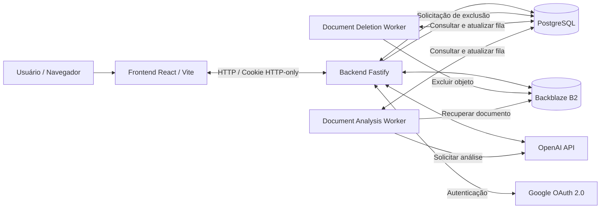

# Jus Digital Document Analyzer

Aplicação web full-stack para autenticação com Google OAuth 2.0, envio e gerenciamento de documentos (`PDF`, `DOCX` e `TXT`), extração de texto e análise orientada por instruções do usuário utilizando Inteligência Artificial (`gpt-4o-mini`). A aplicação utiliza PostgreSQL para persistência, Backblaze B2 para armazenamento privado de arquivos e filas persistentes com workers para processamento assíncrono de análises e exclusões.

---

## Sumário

1. [Visão Geral](#1-visão-geral)
2. [Arquitetura da Aplicação](#2-arquitetura-da-aplicação)
3. [Estrutura do Projeto](#3-estrutura-do-projeto)
4. [Frontend — `apps/web`](#4-frontend--appsweb)
5. [Backend — `apps/api`](#5-backend--appsapi)
6. [Banco de Dados e Persistência](#6-banco-de-dados-e-persistência)
7. [Autenticação Google OAuth 2.0](#7-autenticação-google-oauth-20)
8. [Armazenamento — Backblaze B2](#8-armazenamento--backblaze-b2)
9. [Filas e Workers](#9-filas-e-workers)
10. [API e Principais Fluxos](#10-api-e-principais-fluxos)
11. [Instalação e Execução Local](#11-instalação-e-execução-local)
12. [Variáveis de Ambiente](#12-variáveis-de-ambiente)
13. [Testes e Validação](#13-testes-e-validação)
14. [Deploy em Produção](#14-deploy-em-produção)
15. [Decisões Técnicas e Segurança](#15-decisões-técnicas-e-segurança)

---

## 1. Visão Geral

O **Jus Digital Document Analyzer** é uma aplicação web desenvolvida para centralizar o envio, o gerenciamento e a análise de documentos com auxílio de Inteligência Artificial.

O usuário pode enviar documentos, informar uma instrução sobre o tipo de análise desejada e consultar o resultado posteriormente. O sistema mantém os documentos associados ao usuário autenticado, armazena os arquivos em um bucket privado e persiste os metadados e resultados no PostgreSQL.

### Funcionalidades principais

- Autenticação de usuários por Google OAuth 2.0.
- Gerenciamento de sessão por cookie HTTP-only.
- Upload de documentos nos formatos PDF, DOCX e TXT.
- Validação de formato e tamanho dos arquivos.
- Extração de texto dos documentos enviados.
- Análise de conteúdo por meio da API da OpenAI.
- Instruções personalizadas para orientar a análise.
- Listagem e visualização dos documentos.
- Pré-visualização da capa de arquivos PDF no cliente.
- Reprocessamento de documentos com falha.
- Exclusão individual e múltipla de documentos.
- Fila persistente para processamento de análises e exclusões.
- Processamento de análises em segundo plano, sem manter a requisição de upload ou retry aguardando a OpenAI.
- Tentativas automáticas de exclusão em caso de falhas no armazenamento e reagendamento de falhas temporárias na análise.
- Isolamento dos documentos por usuário.

### Tecnologias principais

| Camada | Tecnologias |
|---|---|
| Frontend | React, TypeScript, Vite |
| Estilização | Tailwind CSS, CSS Variables |
| Componentes | Radix UI, Lucide React |
| Estado remoto | TanStack Query |
| Backend | Node.js, TypeScript, Fastify |
| ORM | Prisma |
| Banco de dados | PostgreSQL |
| Armazenamento | Backblaze B2, API compatível com S3 |
| Integração S3 | `@aws-sdk/client-s3` |
| Inteligência Artificial | OpenAI API (`gpt-4o-mini`) |
| Autenticação | Google OAuth 2.0 |
| Testes | Vitest, React Testing Library, MSW e Playwright |
| Frontend em produção | Vercel |
| Backend em produção | Railway |

---

## 2. Arquitetura da Aplicação

A aplicação utiliza uma arquitetura dividida entre frontend, backend, banco de dados e serviços externos.

### 2.1. Componentes

- **Frontend (`apps/web`)**: aplicação SPA responsável pela interface, navegação, interação com o usuário, validações preliminares e comunicação com a API.
- **Backend (`apps/api`)**: API REST responsável pela autenticação, regras de negócio, validações definitivas, processamento dos documentos e comunicação com os serviços externos.
- **PostgreSQL**: persistência de usuários, documentos, resultados de análise e informações necessárias ao processamento das filas de análise e exclusão.
- **Backblaze B2**: armazenamento privado dos arquivos enviados.
- **Google OAuth 2.0**: autenticação dos usuários.
- **OpenAI API**: análise do conteúdo extraído dos documentos.

### 2.2. Diagrama da arquitetura



### 2.3. Fluxo geral de utilização

1. O usuário acessa o frontend.
2. O usuário inicia a autenticação por Google OAuth 2.0.
3. O backend processa o callback, registra ou atualiza o usuário e estabelece a sessão.
4. O usuário seleciona um documento e informa o título e a instrução de análise.
5. O frontend envia o arquivo à API por `multipart/form-data`.
6. O backend valida o arquivo, armazena o objeto no Backblaze B2, persiste seus metadados e registra a análise na fila.
7. A API retorna o documento com status `PROCESSING`, sem aguardar a extração de texto ou a resposta da OpenAI.
8. O worker de análise recupera o arquivo, extrai o texto e solicita a análise à OpenAI.
9. O resultado ou a falha do processamento é persistido, e o usuário pode consultar, reprocessar ou excluir o documento.

---

## 3. Estrutura do Projeto

O projeto é organizado como um monorepo com workspaces npm, separando frontend e backend em aplicações independentes.

```text
doc-analyzer/
│
├── apps/
│   ├── api/
│   │   ├── prisma/
│   │   │   ├── migrations/
│   │   │   └── schema.prisma
│   │   │
│   │   ├── src/
│   │   │   ├── config/
│   │   │   │   └── env.ts
│   │   │   │
│   │   │   ├── integrations/
│   │   │   │   ├── openai/
│   │   │   │   ├── storage/
│   │   │   │   └── text-extraction/
│   │   │   │
│   │   │   ├── modules/
│   │   │   │   ├── auth/
│   │   │   │   ├── documents/
│   │   │   │   └── health/
│   │   │   │
│   │   │   ├── repositories/
│   │   │   │
│   │   │   ├── shared/
│   │   │   │
│   │   │   └── app.ts
│   │   │
│   │   ├── tests/
│   │   │   ├── helpers/
│   │   │   ├── integration/
│   │   │   └── unit/
│   │   │
│   │   └── package.json
│   │
│   └── web/
│       ├── e2e/
│       ├── src/
│       │   ├── app/
│       │   ├── components/
│       │   │   ├── layout/
│       │   │   └── ui/
│       │   ├── features/
│       │   │   ├── auth/
│       │   │   └── documents/
│       │   ├── lib/
│       │   ├── styles/
│       │   └── test/
│       ├── package.json
│       └── vercel.json
│
├── docker-compose.yml
├── package.json
├── package-lock.json
└── README.md
```

### 3.1. Responsabilidades dos diretórios

| Diretório | Responsabilidade |
|---|---|
| `apps/api/prisma/` | Schema do banco e histórico de migrações |
| `apps/api/src/config/` | Configurações e validação do ambiente |
| `apps/api/src/integrations/` | Integrações com serviços externos |
| `apps/api/src/modules/` | Módulos de negócio e suas funcionalidades |
| `apps/api/src/repositories/` | Acesso e persistência de dados |
| `apps/api/src/shared/` | Recursos compartilhados, banco e tratamento de erros |
| `apps/api/tests/` | Testes unitários, integração e auxiliares |
| `apps/web/src/app/` | Inicialização, providers e roteamento |
| `apps/web/src/components/` | Componentes compartilhados |
| `apps/web/src/features/` | Funcionalidades organizadas por domínio |
| `apps/web/src/lib/` | Utilitários, HTTP e validações |
| `apps/web/src/styles/` | Tokens e estilos globais |
| `apps/web/e2e/` | Testes automatizados de ponta a ponta |

---

## 4. Frontend — `apps/web`

### 4.1. Stack

- React.
- TypeScript.
- Vite.
- Tailwind CSS.
- Radix UI.
- Lucide React.
- Sonner.
- TanStack Query.
- `pdfjs-dist`.

A aplicação utiliza Vite como ferramenta de desenvolvimento e build, com porta `5173` e `strictPort` habilitado.

### 4.2. Organização por funcionalidades

**`src/app/`**

Responsável pela inicialização da aplicação:

- `providers.tsx`: providers globais.
- `query-client.ts`: configuração do TanStack Query.
- `router.tsx`: definição das rotas e proteção de acesso.
- Tratamento global de sessão e autenticação.

**`src/features/auth/`**

Responsável pela autenticação e estado da sessão:

- Comunicação com os endpoints de autenticação.
- Consulta do usuário autenticado por `GET /me`.
- Proteção de rotas por `RequireAuth.tsx`.
- Página de login em `LoginPage.tsx`.

**`src/features/documents/`**

Responsável pelo gerenciamento de documentos:

- `types.ts`: tipos e contratos utilizados na feature.
- `api.ts`: comunicação com os endpoints de documentos.
- `queries.ts`: consultas e mutações do TanStack Query.
- Hooks de seleção, picker, drag-and-drop e exclusão.
- `DocumentsPage.tsx`: página principal de documentos.
- `DocumentsEmptyState`: estado vazio.
- `DocumentGrid`: grade de documentos.
- `DocumentCard`: apresentação individual.
- `SelectionBar`: ações dos itens selecionados.
- `UploadModal`: envio de documentos.
- `AnalysisModal`: visualização da análise.
- `ConfirmDeleteDialog`: confirmação de exclusão.
- `FilePreviewBlock`: apresentação das informações e prévia do arquivo.

**`src/components/`**

Contém componentes compartilhados da aplicação:

- `layout/`: estrutura visual, como `AppShell` e `Sidebar`.
- `ui/`: componentes de interface baseados e adaptados de Radix UI.

**`src/lib/`**

Concentra funcionalidades reutilizáveis:

- `http.ts`: cliente HTTP, `ApiError`, envio de credenciais e tratamento de respostas.
- `errors.ts`: conversão de códigos de erro em mensagens amigáveis em português.
- `format.ts`: formatação de dados.
- `file-validation.ts`: validações de arquivos.
- `pdf-cover.ts`: geração da capa de PDF no cliente.
- `utils.ts`: funções auxiliares.

### 4.3. Comunicação com a API

Os componentes não devem realizar chamadas `fetch` diretamente. A comunicação é centralizada na camada HTTP e nos serviços e hooks de cada funcionalidade.

O cliente HTTP:

- Envia cookies utilizando `credentials: 'include'`.
- Trata respostas sem conteúdo, como `204`.
- Centraliza a interpretação de erros.
- Utiliza os códigos de erro da API para apresentar mensagens adequadas.

Quando uma resposta `401` indica expiração de sessão, o frontend limpa o estado de autenticação e os dados em cache, direcionando o usuário para o login e apresentando uma notificação.

### 4.4. Fluxos de documentos

- Seleção por input de arquivo.
- Drag-and-drop.
- Validação preliminar de formato e tamanho.
- Upload com título e instrução obrigatórios.
- Listagem em grade.
- Seleção individual e múltipla.
- Visualização da análise.
- Reprocessamento de documentos com falha.
- Exclusão individual e múltipla.

A interface permite selecionar arquivos PDF, DOCX e TXT, respeitando o limite padrão de `10 MB`.

A prévia de PDF é gerada no navegador por meio do `pdfjs-dist`, sem necessidade de tornar o bucket público.

---

## 5. Backend — `apps/api`

### 5.1. Stack

- Node.js.
- TypeScript.
- Fastify.
- Prisma ORM.
- PostgreSQL.
- AWS SDK para operações S3.
- Integração com Google OAuth 2.0.
- Integração com OpenAI API.

### 5.2. Organização

**`src/config/`**

Configurações do backend, incluindo carregamento e validação das variáveis de ambiente.

**`src/modules/`**

Organiza as funcionalidades por domínio:

- `auth/`: autenticação, sessão, callback OAuth e logout.
- `documents/`: upload, consulta, processamento, retry e exclusão de documentos.
- `health/`: verificação de disponibilidade da API.

O módulo de documentos contém workers independentes para as filas persistentes:

- `src/modules/documents/document-deletion-worker.ts`: processa exclusões de arquivos.
- `src/modules/documents/document-analysis-worker.ts`: processa análises de documentos.

A lógica de execução de uma análise fica separada em `document-analysis-processor.ts`.

**`src/integrations/`**

Camada de comunicação com serviços externos:

- `storage/`: armazenamento de objetos compatível com S3.
- `text-extraction/`: extração de texto dos documentos.
- `openai/`: análise de conteúdo utilizando a API da OpenAI.

**`src/repositories/`**

Responsável pelo acesso aos dados persistidos. O repositório de documentos centraliza operações relacionadas à consulta, atualização e reivindicação de tarefas das filas de análise e exclusão.

**`src/shared/`**

Contém recursos compartilhados, como conexão com banco de dados, logger e tratamento padronizado de erros.

**`src/app.ts`**

Responsável pela composição da aplicação Fastify, registro de plugins, rotas e integração do ciclo de vida do worker.

### 5.3. Regras de negócio

- Todas as operações protegidas exigem sessão autenticada.
- Documentos pertencem a um usuário específico.
- Um usuário não pode acessar documentos de outro usuário.
- Arquivos são validados no backend, independentemente das validações do frontend.
- O reprocessamento é permitido apenas para documentos com status `FAILED`.
- A exclusão é registrada no banco antes de ser processada pelo worker.
- Documentos em exclusão pendente não são apresentados nas consultas normais.
- Erros são retornados em formato estruturado.

Formato padrão:

```json
{
  "error": {
    "code": "UNAUTHORIZED",
    "message": "Mensagem descritiva do erro"
  }
}
```

---

## 6. Banco de Dados e Persistência

### 6.1. Tecnologia

O projeto utiliza PostgreSQL com Prisma ORM.

O schema principal está em:

`apps/api/prisma/schema.prisma`

As migrações estão em:

`apps/api/prisma/migrations/`

O histórico de migrações permite reproduzir a estrutura do banco em diferentes ambientes.

### 6.2. Entidades principais

**User**

Representa os usuários autenticados por Google OAuth 2.0.

**Document**

Representa os documentos enviados e mantém:

- Identificação e vínculo com o usuário.
- Título e instrução de análise.
- Nome original e tipo MIME.
- Tamanho do arquivo.
- Chave de armazenamento do objeto.
- Data de criação.
- Status do processamento.
- Resultado da análise.
- Informações de falha.
- Informações de controle da exclusão.

### 6.3. Estados do documento

O campo `status` representa o estado atual do documento.

| Status | Significado |
|---|---|
| `PROCESSING` | Documento em processamento |
| `COMPLETED` | Análise concluída |
| `FAILED` | Processamento falhou |
| `DELETION_PENDING` | Exclusão solicitada e aguardando processamento |

O estado `DELETION_PENDING` foi introduzido para permitir que a exclusão seja processada de maneira assíncrona e persistente.

### 6.4. Campos da fila de exclusão

Além dos metadados e resultados da análise, o modelo `Document` possui campos específicos para o controle da fila:

| Campo | Finalidade |
|---|---|
| `deletionRequestedAt` | Data e hora da solicitação de exclusão |
| `deletionNextAttemptAt` | Momento a partir do qual uma nova tentativa pode ocorrer |
| `deletionLeaseUntil` | Expiração da reserva temporária do processamento |
| `deletionAttempts` | Quantidade de tentativas realizadas |
| `deletionError` | Último erro registrado durante a exclusão |

A tabela também possui um índice composto para auxiliar a consulta dos documentos elegíveis para processamento:

`documents_deletion_queue_idx`

Esse índice considera o status, o próximo horário de tentativa e a validade do lease.

### 6.5. Campos da fila de análise

A análise também utiliza uma fila persistida no próprio registro `Document`:

| Campo | Finalidade |
|---|---|
| `analysisNextAttemptAt` | Momento a partir do qual a análise pode ser tentada |
| `analysisLeaseUntil` | Expiração da reserva temporária do processamento |
| `analysisAttempts` | Quantidade de tentativas de processamento |
| `analysisError` | Último erro operacional registrado |

O índice `documents_analysis_queue_idx` auxilia a busca de documentos `PROCESSING` elegíveis, considerando o próximo horário de tentativa e a validade do lease.

### 6.6. Ambientes de banco de dados

O `docker-compose.yml` disponibiliza dois serviços PostgreSQL:

| Serviço | Porta | Finalidade |
|---|---:|---|
| `postgres` | `5432` | Desenvolvimento |
| `postgres_test` | `5433` | Testes de integração |

Os testes de integração devem utilizar exclusivamente o banco de testes.

---

## 7. Autenticação Google OAuth 2.0

A autenticação utiliza o protocolo OAuth 2.0 com o Google como provedor de identidade.

### 7.1. Configuração

No Google Cloud Console:

1. Criar um projeto.
2. Configurar a tela de consentimento OAuth.
3. Habilitar os escopos necessários: `openid`, `email` e `profile`.
4. Criar uma credencial OAuth Client ID do tipo aplicação Web.
5. Configurar as URIs de redirecionamento autorizadas.

Exemplos de callback:

**Local:**

`http://localhost:3333/auth/google/callback`

**Produção:**

`https://doc-analyzerapi-production.up.railway.app/auth/google/callback`

### 7.2. Fluxo de autenticação

1. O frontend direciona o navegador para `/auth/google`.
2. O backend inicia o fluxo OAuth e gera o estado de validação.
3. O usuário realiza a autenticação no Google.
4. O Google redireciona para `/auth/google/callback`.
5. O backend valida o retorno OAuth e troca o código de autorização pelos dados de identidade.
6. O usuário é criado ou atualizado no PostgreSQL.
7. O backend estabelece a sessão por meio do cookie `doc_analyzer_session`.
8. O navegador retorna ao frontend.
9. O frontend consulta `GET /me` para recuperar os dados do usuário.

### 7.3. Sessão

A aplicação utiliza cookie HTTP-only:

`doc_analyzer_session`

O cookie não fica disponível diretamente ao JavaScript da aplicação, reduzindo a exposição do identificador de sessão a scripts executados no navegador.

O frontend envia as credenciais nas requisições por meio de:

`credentials: 'include'`

### 7.4. Endpoints de autenticação

| Método | Rota | Finalidade |
|---|---|---|
| `GET` | `/auth/google` | Iniciar autenticação |
| `GET` | `/auth/google/callback` | Processar retorno do Google |
| `GET` | `/me` | Consultar sessão atual |
| `POST` | `/auth/logout` | Encerrar sessão |

O endpoint `GET /me` retorna os dados do usuário autenticado ou `401` quando não existe sessão válida.

O logout encerra a sessão e remove o cookie.

---

## 8. Armazenamento — Backblaze B2

### 8.1. Escolha do provedor

O projeto utiliza o Backblaze B2 como serviço de armazenamento de objetos.

O B2 disponibiliza uma API compatível com S3, permitindo utilizar o SDK oficial da AWS sem implementar uma integração específica para o provedor.

O bucket deve permanecer privado.

### 8.2. Configuração

Para configurar o Backblaze B2:

1. Criar uma conta no Backblaze.
2. Criar um bucket dedicado à aplicação.
3. Manter o bucket privado.
4. Identificar o endpoint S3 e a região.
5. Criar uma Application Key.
6. Restringir as permissões ao bucket necessário.
7. Configurar as credenciais nas variáveis de ambiente do backend.

Exemplo de endpoint:

`https://s3.us-west-004.backblazeb2.com`

### 8.3. Integração com AWS SDK

A integração utiliza:

`@aws-sdk/client-s3`

O cliente é configurado por variáveis de ambiente:

- `S3_ENDPOINT`
- `S3_REGION`
- `S3_ACCESS_KEY_ID`
- `S3_SECRET_ACCESS_KEY`
- `S3_BUCKET`

A utilização de um endpoint configurável permite trocar o Backblaze B2 por outro provedor compatível com S3, como o Amazon S3, sem reescrever as operações principais de armazenamento.

### 8.4. Operações de armazenamento

O backend utiliza operações compatíveis com S3 para:

- Enviar arquivos.
- Recuperar objetos para processamento.
- Gerar URLs pré-assinadas.
- Excluir objetos.

### 8.5. Presigned URLs

O acesso a arquivos privados pode utilizar URLs pré-assinadas.

Essas URLs concedem acesso temporário ao objeto sem tornar o bucket público ou disponibilizar as credenciais de armazenamento ao frontend.

A validade padrão documentada é de `300` segundos.

Boas práticas:

- Não armazenar URLs pré-assinadas permanentemente.
- Não registrar essas URLs em logs.
- Não expor credenciais do storage no frontend.
- Não tornar o bucket público para facilitar a visualização dos documentos.

### 8.6. Segurança

- Manter o bucket privado.
- Utilizar credenciais com privilégio mínimo.
- Restringir as chaves ao bucket da aplicação.
- Não versionar credenciais reais.
- Evitar registrar conteúdo de documentos, cookies e URLs assinadas nos logs.

### 8.7. Configuração equivalente na AWS S3

A integração pode utilizar Amazon S3 diretamente.

Nesse cenário:

1. Criar um bucket na região desejada.
2. Manter o bloqueio de acesso público habilitado.
3. Criar uma política IAM restrita ao bucket.
4. Conceder apenas as permissões necessárias.
5. Configurar as variáveis `S3_REGION`, `S3_ENDPOINT`, `S3_ACCESS_KEY_ID`, `S3_SECRET_ACCESS_KEY` e `S3_BUCKET`.

Como o backend utiliza o SDK S3, as operações principais permanecem iguais. A adaptação fica concentrada na infraestrutura e nas credenciais do provedor.

---

## 9. Filas e Workers

### 9.1. Problema da exclusão direta

O armazenamento de arquivos e o PostgreSQL são serviços independentes. Não existe uma única transação ACID que englobe simultaneamente a exclusão de um objeto no Backblaze B2 e a remoção do registro no banco.

Uma implementação que exclui primeiro o objeto e depois remove o registro pode deixar o sistema inconsistente se uma das operações falhar.

Para evitar esse problema, a aplicação utiliza uma fila persistente de exclusão baseada no próprio PostgreSQL.

### 9.2. Novo fluxo de exclusão

A operação `DELETE /documents/:id` não realiza diretamente a exclusão física do arquivo.

O fluxo funciona da seguinte maneira:

1. O backend identifica o documento e verifica sua propriedade.
2. O documento é marcado como `DELETION_PENDING`.
3. A solicitação e as informações de controle da exclusão são persistidas no PostgreSQL.
4. O endpoint retorna `204 No Content`.
5. O worker identifica documentos pendentes e elegíveis.
6. O worker reivindica o documento para processamento.
7. O objeto correspondente é excluído do Backblaze B2.
8. Após a confirmação da exclusão no storage, o registro é removido do PostgreSQL.

A resposta `204` indica que a solicitação de exclusão foi aceita e registrada. Ela não significa que a remoção física já terminou.

### 9.3. Processamento pelo worker

O processamento está implementado em:

`apps/api/src/modules/documents/document-deletion-worker.ts`

O worker:

- Consulta documentos com status `DELETION_PENDING`.
- Identifica tarefas cujo horário de tentativa já foi alcançado.
- Reivindica tarefas para evitar processamento simultâneo.
- Exclui o objeto no storage.
- Remove o registro do banco após o sucesso.
- Registra falhas e programa novas tentativas.

### 9.4. Concorrência e lease

O repositório utiliza uma operação atômica com:

`FOR UPDATE SKIP LOCKED`

Esse mecanismo permite que diferentes instâncias do worker processem tarefas distintas sem reivindicar simultaneamente o mesmo registro.

O lease representa uma reserva temporária do processamento.

Quando a reserva expira, o documento pode voltar a ser elegível para outra tentativa, evitando que uma tarefa fique permanentemente presa a uma instância que deixou de funcionar.

### 9.5. Retry e backoff exponencial

Quando ocorre uma falha na exclusão do objeto, o worker:

1. Mantém o documento no banco.
2. Incrementa o contador de tentativas.
3. Registra o erro.
4. Calcula o próximo horário de tentativa.
5. Libera a tarefa para processamento futuro.

A espera aumenta progressivamente de acordo com uma estratégia de backoff exponencial.

Parâmetros padrão implementados:

| Parâmetro | Valor |
|---|---:|
| Intervalo de polling | 5 segundos |
| Duração do lease | 60 segundos |
| Intervalo inicial de retry | 5 segundos |
| Limite máximo de retry | 1 hora |

O objetivo é evitar tentativas excessivamente frequentes quando o provedor de armazenamento apresenta indisponibilidade.

### 9.6. Ciclo de vida do worker

O worker é integrado ao ciclo de vida do Fastify:

- Inicia automaticamente nos ambientes em que o processamento está habilitado.
- Executa uma varredura inicial ao iniciar.
- Realiza novas varreduras periodicamente.
- Não é iniciado em `NODE_ENV=test`.
- É interrompido durante o encerramento da aplicação.
- Aguarda o processamento em andamento antes de concluir sua parada.

### 9.7. Visibilidade dos documentos pendentes

Documentos com status `DELETION_PENDING` não aparecem nas consultas normais de listagem e recuperação.

Isso impede que documentos cuja exclusão já foi solicitada continuem sendo apresentados ao usuário enquanto aguardam a remoção física.

### 9.8. Migração do banco

A fila de exclusão exigiu alterações no schema Prisma:

- Adiciona o estado `DELETION_PENDING` ao enum `DocumentStatus`.
- Adiciona os campos de controle da fila.
- Cria o índice utilizado na consulta das tarefas de exclusão.

A migração deve ser aplicada em cada ambiente antes de executar a versão do backend que depende desses campos. A aplicação em produção deve ocorrer como parte do procedimento de deploy.

### 9.9. Garantias e limitações da exclusão

A fila persistente permite recuperar tarefas após reinicializações do backend e repetir operações que falharam.

Entretanto, a exclusão continua dependendo da disponibilidade do provedor de armazenamento e do banco. O sistema não oferece uma transação distribuída entre os dois serviços.

A estratégia adotada prioriza consistência eventual: o registro permanece no banco enquanto a exclusão física não for concluída.

### 9.10. Fila de análise e worker

A análise de documentos também é executada por uma fila persistida no PostgreSQL. Assim, o upload e o retry não precisam aguardar a extração do texto nem a chamada à OpenAI para responder ao usuário.

O fluxo funciona da seguinte maneira:

1. Após validar e armazenar o arquivo, a API cria o registro do documento com status `PROCESSING` e agenda a análise.
2. O endpoint de upload retorna `201` com o documento ainda em processamento.
3. O worker identifica tarefas `PROCESSING` cujo horário de tentativa foi alcançado e cujo lease está ausente ou expirado.
4. O worker recupera o arquivo no Backblaze B2, extrai o texto e solicita a análise à OpenAI.
5. Em caso de sucesso, o resultado é salvo e o documento passa para `COMPLETED`.
6. Em caso de falha definitiva de processamento, o documento passa para `FAILED` com as informações da falha.
7. Falhas operacionais temporárias, como indisponibilidade ao recuperar o arquivo, são reagendadas para uma nova tentativa.

O worker está implementado em `apps/api/src/modules/documents/document-analysis-worker.ts`, enquanto `document-analysis-processor.ts` concentra a extração e a chamada ao analisador.

O retry de um documento `FAILED` apenas reinicializa os dados de controle da fila e devolve o documento ao estado `PROCESSING`. A requisição não executa a análise diretamente.

A reivindicação das tarefas utiliza `FOR UPDATE SKIP LOCKED` e lease temporário para reduzir o risco de duas instâncias processarem a mesma tarefa simultaneamente. O worker consulta a fila periodicamente, inicia com o backend e não é iniciado em `NODE_ENV=test`.

Parâmetros padrão implementados:

| Parâmetro | Valor |
|---|---:|
| Intervalo de polling | 1 segundo |
| Duração do lease | 5 minutos |
| Backoff inicial | 5 segundos |
| Backoff máximo | 1 hora |

O resultado da análise é persistido no PostgreSQL e pode ser consultado posteriormente pelo endpoint de detalhes do documento.

---

## 10. API e Principais Fluxos

A especificação contratual da API está disponível em:

- `apps/api/openapi.json`
- `/documentation`
- `/documentation/json`

### 10.1. Endpoints

| Método | Rota | Autenticação | Descrição |
|---|---|---|---|
| `GET` | `/health` | Não | Verifica disponibilidade da API |
| `GET` | `/auth/google` | Não | Inicia autenticação Google |
| `GET` | `/auth/google/callback` | Não | Processa callback OAuth |
| `GET` | `/me` | Cookie | Consulta usuário autenticado |
| `POST` | `/auth/logout` | Cookie | Encerra a sessão |
| `POST` | `/documents` | Cookie | Envia documento e agenda a análise |
| `GET` | `/documents` | Cookie | Lista documentos do usuário |
| `GET` | `/documents/:id` | Cookie | Consulta detalhes e análise |
| `POST` | `/documents/:id/retry` | Cookie | Reprocessa documento com falha |
| `DELETE` | `/documents/:id` | Cookie | Solicita exclusão do documento |

### 10.2. Respostas principais

| Endpoint | Respostas principais |
|---|---|
| `GET /health` | `200` |
| `GET /auth/google` | `302` |
| `GET /auth/google/callback` | `302`, `400`, `401` |
| `GET /me` | `200`, `401` |
| `POST /auth/logout` | `204`, `401` |
| `POST /documents` | `201`, `400`, `401`, `413`, `415`, `500`, `502` |
| `GET /documents` | `200`, `401`, `500` |
| `GET /documents/:id` | `200`, `400`, `401`, `404`, `500`, `502` |
| `POST /documents/:id/retry` | `200`, `400`, `401`, `404`, `409`, `500` |
| `DELETE /documents/:id` | `204`, `400`, `401`, `404`, `500` |

A exclusão retorna `204` após registrar a solicitação. Uma falha posterior no Backblaze B2 é tratada pelo worker, não como uma falha síncrona da requisição original.

### 10.3. Upload e análise

O endpoint `POST /documents` recebe `multipart/form-data` com:

- `title`: título do documento.
- `instruction`: instrução de análise.
- `file`: arquivo enviado.

Validações:

| Campo | Regra |
|---|---|
| Arquivo | PDF, DOCX ou TXT |
| Tamanho | Até 10 MB por padrão |
| `title` | 1 a 120 caracteres |
| `instruction` | 1 a 2.000 caracteres |

Após as validações, o backend armazena o arquivo, cria o registro e agenda a análise. A resposta inicial contém o documento com status `PROCESSING`; a extração de texto e a chamada à OpenAI acontecem posteriormente no worker.

### 10.4. Principais fluxos

**Login**

`/auth/google` → Google → `/auth/google/callback` → cookie de sessão → frontend → `GET /me`.

**Upload**

Seleção de arquivo → validação → preenchimento dos campos → `POST /documents` → armazenamento e criação do registro `PROCESSING` → resposta da API → worker → extração e análise → persistência do resultado.

**Listagem**

`GET /documents` → consulta dos documentos do usuário → apresentação na grade.

**Visualização**

`GET /documents/:id` → recuperação dos detalhes e da análise → apresentação no modal.

**Retry**

`POST /documents/:id/retry` → validação do estado `FAILED` → reinicialização da tarefa na fila → resposta `PROCESSING` → processamento posterior pelo worker.

**Exclusão individual**

Confirmação → `DELETE /documents/:id` → estado `DELETION_PENDING` → worker → exclusão no storage → remoção no banco.

**Exclusão múltipla**

Confirmação → chamadas sequenciais para `DELETE /documents/:id` → tratamento individual das respostas → atualização da listagem.

**Logout**

`POST /auth/logout` → encerramento da sessão → limpeza do estado do frontend → redirecionamento para `/login`.

---

## 11. Instalação e Execução Local

### 11.1. Pré-requisitos

- Node.js.
- npm.
- Docker.
- Docker Compose.
- Credenciais do Google OAuth 2.0.
- Chave da API da OpenAI.
- Credenciais de armazenamento do Backblaze B2 ou outro provedor S3-compatível.

### 11.2. Clonar o projeto

```bash
git clone <URL_DO_REPOSITORIO>
cd doc-analyzer
```

### 11.3. Instalar dependências

```bash
npm install
```

### 11.4. Configurar o ambiente

```bash
cp .env.example .env
cp apps/web/.env.example apps/web/.env
```

Preencha as variáveis necessárias de acordo com os exemplos e descrições da seção de variáveis de ambiente.

Não versione arquivos `.env` reais.

### 11.5. Subir os bancos

```bash
docker compose up -d postgres postgres_test
```

Portas:

- Desenvolvimento: `localhost:5432`.
- Testes: `localhost:5433`.

### 11.6. Gerar Prisma Client e aplicar migrações

```bash
npx prisma generate --schema apps/api/prisma/schema.prisma

npx prisma migrate dev --schema apps/api/prisma/schema.prisma
```

O comando de migração aplica as migrações pendentes ao banco configurado em `DATABASE_URL`.

### 11.7. Executar o backend

```bash
npm run dev
```

API:

`http://localhost:3333`

### 11.8. Executar o frontend

Em outro terminal:

```bash
npm run dev -w apps/web
```

Frontend:

`http://localhost:5173`

### 11.9. Configuração OAuth local

Para o login local, configure:

- `WEB_URL=http://localhost:5173`
- `API_URL=http://localhost:3333`
- `GOOGLE_REDIRECT_URI=http://localhost:3333/auth/google/callback`

O navegador deve utilizar `localhost`, evitando misturar `localhost` e `127.0.0.1` durante o fluxo de autenticação.

---

## 12. Variáveis de Ambiente

Os valores abaixo são exemplos ilustrativos. Credenciais reais devem ser configuradas diretamente nos ambientes de execução.

### 12.1. Backend

| Variável | Finalidade | Obrigatória |
|---|---|---|
| `NODE_ENV` | Ambiente de execução | Sim |
| `PORT` | Porta HTTP da API | Não |
| `API_URL` | URL pública/base da API | Sim |
| `WEB_URL` | URL do frontend e origem autorizada | Sim |
| `DATABASE_URL` | Conexão PostgreSQL principal | Sim |
| `TEST_DATABASE_URL` | Banco exclusivo dos testes de integração | Para integração |
| `GOOGLE_CLIENT_ID` | Identificador OAuth do Google | Sim |
| `GOOGLE_CLIENT_SECRET` | Segredo OAuth do Google | Sim |
| `GOOGLE_REDIRECT_URI` | Callback OAuth | Sim |
| `SESSION_SECRET` | Segredo de assinatura da sessão | Sim |
| `S3_ENDPOINT` | Endpoint S3-compatível | Conforme provedor |
| `S3_REGION` | Região do armazenamento | Sim |
| `S3_ACCESS_KEY_ID` | Identificador da chave S3 | Sim |
| `S3_SECRET_ACCESS_KEY` | Segredo da chave S3 | Sim |
| `S3_BUCKET` | Nome do bucket | Sim |
| `OPENAI_API_KEY` | Chave da API OpenAI | Sim |
| `OPENAI_MODEL` | Modelo de IA utilizado | Não |
| `OPENAI_TIMEOUT_MS` | Timeout da chamada à OpenAI | Conforme configuração |
| `MAX_FILE_SIZE_MB` | Limite de tamanho do arquivo | Não |
| `MAX_TEXT_CHARS` | Limite de caracteres extraídos | Conforme configuração |

Exemplos de valores não secretos:

```env
NODE_ENV=development
PORT=3333
API_URL=http://localhost:3333
WEB_URL=http://localhost:5173
OPENAI_MODEL=gpt-4o-mini
MAX_FILE_SIZE_MB=10
```

### 12.2. Frontend

| Variável | Finalidade | Obrigatória |
|---|---|---|
| `VITE_API_URL` | URL base da API | Sim |
| `E2E_BASE_URL` | URL do frontend para Playwright | Para E2E |
| `E2E_API_URL` | URL da API para verificações E2E | Para E2E |
| `E2E_SESSION_COOKIE` | Cookie de sessão utilizado nos testes E2E | Para E2E |

Em desenvolvimento, `VITE_API_URL` pode apontar para `http://localhost:3333`.

Em produção, pode permanecer vazio quando a aplicação utiliza os rewrites same-origin da Vercel.

> Variáveis com prefixo `VITE_` são incorporadas ao bundle público do frontend. Nunca armazene segredos nelas.

Os arquivos `.env`, `apps/web/.env` e `apps/web/.env.e2e` devem permanecer fora do controle de versão.

---

## 13. Testes e Validação

O projeto possui testes automatizados em diferentes camadas, permitindo validar regras de negócio, integração com o banco, comportamento dos componentes e fluxos completos da aplicação.

### 13.1. Verificações estáticas e build

```bash
npm run typecheck
npm run lint
npm run build -w apps/web
npm run build -w apps/api
```

### 13.2. Backend

**Testes unitários**

```bash
npm run test:unit -w apps/api
```

Os testes unitários validam serviços, regras de negócio, repositórios simulados, schemas e o processamento das filas de exclusão e análise.

**Testes de integração**

```bash
docker compose up -d postgres_test

npm run test:integration -w apps/api
```

Os testes de integração utilizam um banco PostgreSQL exclusivo e verificam o comportamento real da API e da persistência.

A configuração deve apontar `TEST_DATABASE_URL` para o banco de testes, nunca para o banco de produção.

### 13.3. Frontend

**Testes unitários e de componentes**

```bash
npm run test -w apps/web
```

Tecnologias:

- Vitest.
- React Testing Library.
- MSW.

**Testes E2E**

1. Copiar `apps/web/.env.e2e.example` para `apps/web/.env.e2e`.
2. Configurar `E2E_BASE_URL`, `E2E_API_URL` e `E2E_SESSION_COOKIE`.
3. Executar:

```bash
npm run test:e2e -w apps/web
```

Os testes verificam os fluxos da aplicação e limpam os documentos criados para os cenários automatizados.

O login interativo do Google não é automatizado pela suíte E2E e deve ser validado separadamente.

### 13.4. Cobertura da exclusão resiliente

A implementação da fila de exclusão possui testes específicos para:

- Solicitação de exclusão.
- Marcação do documento como `DELETION_PENDING`.
- Ocultação de documentos pendentes nas consultas normais.
- Processamento de exclusões pelo worker.
- Exclusão do objeto antes da remoção do registro.
- Tratamento de falhas no storage.
- Reprogramação de tentativas.
- Backoff exponencial.
- Elegibilidade de documentos para processamento.

### 13.5. Cobertura da análise assíncrona

A análise assíncrona possui testes específicos para:

- Reivindicação de documentos pendentes.
- Processamento e conclusão de uma análise.
- Tratamento de falhas na recuperação do arquivo.
- Reagendamento de falhas operacionais.
- Registro de falhas de análise.
- Rejeição de formatos não suportados.

### 13.6. Validação registrada

Na validação realizada em 20/11/2026 para a implementação da exclusão resiliente:

| Verificação | Resultado |
|---|---|
| Typecheck do backend | Aprovado |
| Testes unitários do backend | 133 aprovados |
| Testes de integração do backend | 70 aprovados |
| Total de testes do backend | 203 aprovados |
| `git diff --check` | Sem erros |

Os resultados acima representam a execução registrada para essa alteração, não uma garantia de que todas as suítes do projeto foram executadas novamente após qualquer mudança posterior.

---

## 14. Deploy em Produção

### 14.1. Frontend — Vercel

A aplicação web está publicada em:

`https://doc-analyzer-delta.vercel.app`

O frontend é compilado como aplicação estática, com fallback de SPA configurado em:

`apps/web/vercel.json`

A configuração de produção utiliza `VITE_API_URL` vazio e rewrites same-origin para encaminhar as requisições à API hospedada no Railway.

Esse modelo permite que o navegador se comunique com a API pelo domínio do frontend, facilitando o uso de cookies first-party.

### 14.2. Backend — Railway

A API está publicada em:

`https://doc-analyzerapi-production.up.railway.app`

Comandos de referência:

```bash
npm run build -w apps/api
npm run start -w apps/api
```

O processo de inicialização do backend registra os workers de exclusão e análise, quando o ambiente permite seu funcionamento. Ambos são encerrados junto ao ciclo de vida da aplicação.

### 14.3. Configurações de produção

As variáveis principais devem estar configuradas no ambiente do Railway:

- `NODE_ENV`
- `PORT`
- `API_URL`
- `WEB_URL`
- `DATABASE_URL`
- `GOOGLE_CLIENT_ID`
- `GOOGLE_CLIENT_SECRET`
- `GOOGLE_REDIRECT_URI`
- `SESSION_SECRET`
- `S3_ENDPOINT`
- `S3_REGION`
- `S3_ACCESS_KEY_ID`
- `S3_SECRET_ACCESS_KEY`
- `S3_BUCKET`
- `OPENAI_API_KEY`

O frontend deve possuir as configurações públicas necessárias para a comunicação com a API.

## 15. Decisões Técnicas e Segurança

### 15.1. Monorepo com npm workspaces

Frontend e backend são mantidos em aplicações separadas dentro do mesmo repositório.

Essa organização permite compartilhar o gerenciamento de dependências e manter os limites de responsabilidade entre as aplicações.

### 15.2. Fastify e Prisma

O Fastify é utilizado como framework HTTP do backend, enquanto o Prisma centraliza o acesso ao PostgreSQL e a evolução do schema por migrações.

### 15.3. Sessão por cookie HTTP-only

A autenticação utiliza cookie HTTP-only em vez de armazenar tokens de sessão em `localStorage` ou `sessionStorage`.

O frontend consulta `GET /me` para validar a sessão e recuperar os dados do usuário.

### 15.4. Proxy same-origin

Os rewrites da Vercel encaminham as requisições para a API no Railway por meio do domínio do frontend.

Essa decisão reduz os problemas associados ao uso de cookies entre domínios distintos.

### 15.5. Armazenamento privado e compatível com S3

O Backblaze B2 foi escolhido por sua compatibilidade com a API S3 e pela possibilidade de integração com o SDK oficial da AWS.

O bucket permanece privado, e o acesso temporário aos arquivos pode ocorrer por URLs pré-assinadas.

### 15.6. Validação no frontend e backend

O frontend realiza validações preliminares para melhorar a experiência do usuário.

O backend repete as validações e permanece como autoridade sobre as regras de negócio, impedindo que a segurança dependa exclusivamente do navegador.

### 15.7. Exclusão assíncrona e persistente

A exclusão utiliza uma fila persistida no PostgreSQL, em vez de depender exclusivamente de uma operação síncrona entre banco e storage.

A decisão permite:

- Registrar a intenção de exclusão antes de remover o objeto.
- Recuperar tarefas após reinicializações.
- Repetir operações que falharam.
- Evitar que instâncias concorrentes processem a mesma tarefa simultaneamente.
- Manter os documentos pendentes fora das consultas normais.

### 15.8. Exclusão múltipla sequencial no frontend

A interface executa chamadas individuais de exclusão em sequência, em vez de utilizar um endpoint de lote.

Isso permite tratar o resultado de cada documento individualmente e preservar na seleção os itens cuja solicitação não foi concluída.

### 15.9. Tratamento centralizado de erros

A API utiliza códigos estruturados para identificar falhas, e o frontend converte esses códigos em mensagens adequadas ao usuário.

Essa abordagem evita depender de mensagens internas ou detalhes de implementação do servidor.

### 15.10. Segurança de credenciais e dados

- Segredos permanecem no backend.
- Arquivos `.env` reais não devem ser versionados.
- Credenciais S3 devem ter privilégios mínimos.
- O bucket deve permanecer privado.
- Cookies de sessão não devem ser registrados em logs.
- URLs pré-assinadas não devem ser armazenadas permanentemente.
- Os endpoints de documentos devem respeitar o vínculo entre usuário e recurso.
